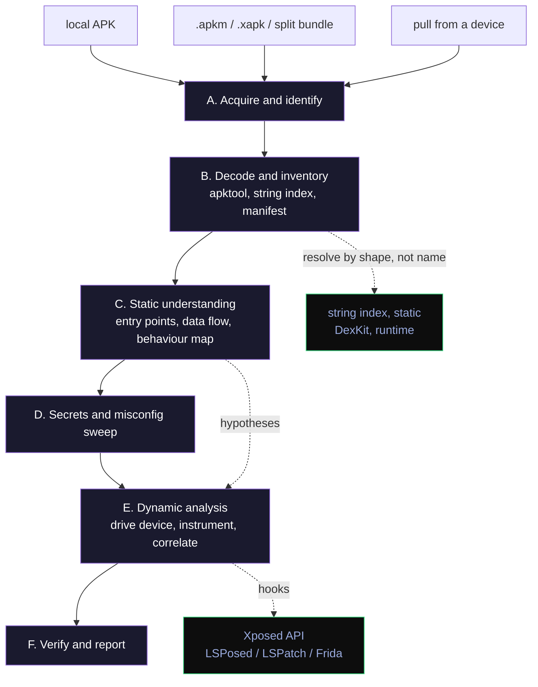

<div align="center">

# molt-DEX

**Shed an app's skin and read what's underneath.**

A staged, evidence-first skill for reverse-engineering, modding, and assessing Android apps,
from plain APKs to heavily obfuscated ones. Built on apktool, adb and scrcpy, with runtime
resolution and hooking through DexKit and the Xposed API.

<p>
  
  
  
  
</p>

</div>

---

## What it is

molt-DEX is a [Claude skill](https://docs.claude.com/en/docs/claude-code/skills): a packaged
pipeline that takes an Android app from "here is an APK" to "here is how it is built, how it
behaves, and where its weaknesses are."

It was distilled from real work, reverse-engineering and modding a large, obfuscated app
(Instagram) across many versions. The techniques that survived version after version are the ones
baked in here.

- **Full obfuscation spectrum.** Plain apps, R8/ProGuard name obfuscation, string encryption,
  reflection, packing, native stubs, and anti-tamper, each with a way to detect it and a way
  through it.
- **apktool, not JADX.** It reasons over apktool-decoded smali and resources, which round-trip
  (you can rebuild and reinstall). A Java decompile is an optional convenience, never the source
  of truth.
- **Static to understand, device to confirm.** Read the code to form a hypothesis, then prove or
  kill it on a real device with adb and scrcpy. Every claim cites evidence: a smali method, a
  string-table hit, a logcat line, a screenshot.

## Why it holds up: resolve by shape, not by name

This is the whole idea. In an obfuscated app you almost never have the real name of a class or
method, and whatever name it has changes on the next release. So you never anchor on names. You
anchor on things that stay put:

- **literal strings** a method uses (log lines, error text, QPL tags),
- **JSON / wire keys** it parses,
- **method shape** (parameter types, return type, static vs instance, arity),
- **class relationships** (superclass, implemented interface, callers and callees),
- **resource names**.

Find the member by that description, statically (a string index over the decoded tree) and at
runtime (a DexKit query inside the live app). When the app updates and the method moves, you
re-run the same description and find it again. This is why a module built this way keeps working
when Instagram ships a new build, and it is the backbone of every stage below.

## Authorization: what the work touches

The line that matters is **self-contained work vs reaching other people's systems**, not static
vs dynamic.

| Category | Examples | Needs |
|---|---|---|
| **Static analysis** | Decode, read, index, map a local APK | Always fine |
| **Local modding / on-device** | Install on *your* device and account, drive the UI, instrument with Frida / LSPosed / LSPatch, build a module that changes *your own* copy | Fine, no authorization. This is the Instagram-module case |
| **Assessment of a target** | Test a backend with crafted traffic, probe another account, a pentest or VA you were engaged for | **Gated**: state target, basis, scope; record it in an engagement log |

It refuses, regardless of stated purpose, to touch third-party accounts or data, to hit backends
you are not authorized to test, to harvest credentials, or to build something to harm others.
See [`references/00-authorization.md`](references/00-authorization.md).

> Use it only for work you have the right to do. See the [disclaimer](DISCLAIMER.md).

## The pipeline



Static reading (A to D) runs on a local file and is always fine. The device work in E is local
modding on your own device unless an action reaches a backend or another account, which is the one
gated case. Each stage is resumable and writes to a working directory and a findings ledger.

| Stage | Page | What it does |
|---|---|---|
| **A. Acquire & identify** | [`01-acquire.md`](references/01-acquire.md) | Get the artifact (local, pulled from a device, or an `.apkm`/`.xapk`/split bundle); record identity and hashes |
| **B. Decode & inventory** | [`02-decode-inventory.md`](references/02-decode-inventory.md) | apktool decode, build the string index, parse the manifest, map the attack surface |
| **C. Static understanding** | [`03-static-understanding.md`](references/03-static-understanding.md) | Entry points, data flow, network layer, and a behaviour map |
| **D. Secrets & misconfig** | [`04-secrets-misconfig.md`](references/04-secrets-misconfig.md) | Sweep for hardcoded secrets and misconfiguration |
| **E. Dynamic analysis** | [`05-dynamic-analysis.md`](references/05-dynamic-analysis.md) | Install, drive with scrcpy + adb, instrument, correlate against the static model |
| **F. Verify & report** | [`06-verify-report.md`](references/06-verify-report.md) | Re-prove each finding, then write the report |

Supporting references:

- [`07-runtime-resolution-instrumentation.md`](references/07-runtime-resolution-instrumentation.md)
  , DexKit (resolve by query at runtime), the Xposed hooking API, and the frameworks that provide
  it: LSPosed (root), LSPatch (no root), and Frida.
- [`obfuscation-ladder.md`](references/obfuscation-ladder.md), the none -> name -> string ->
  packer playbook, each rung with how to detect it and the tactic.
- [`tooling-setup.md`](references/tooling-setup.md), install and sanity-check the tools.
- [`device-loop.md`](references/device-loop.md), the scrcpy + adb screenshot/act loop with every
  gotcha and its fix.

## Tooling

| Tool | Role |
|---|---|
| [apktool](https://github.com/iBotPeaches/Apktool) | Decode and rebuild smali + resources (the core; **not** JADX) |
| [adb](https://developer.android.com/tools/adb) (platform-tools) | Install, logcat, UI dump, file pull, device introspection |
| [scrcpy](https://github.com/Genymobile/scrcpy) | Mirror and drive the device while watching behaviour |
| [ripgrep](https://github.com/BurntSushi/ripgrep) + a string index | Anchor on literals across the decoded tree |
| [DexKit](https://github.com/LuckyPray/DexKit) | Resolve obfuscated members by string / shape / relationship at runtime |
| Xposed API via [LSPosed](https://github.com/JingMatrix/LSPosed) / [LSPatch](https://github.com/JingMatrix/LSPatch) / [Frida](https://github.com/frida/frida) | Hook and observe a running app (root, no-root, or no-install) |
| apksigner, a native disassembler, an intercepting proxy | Re-pack testing, `.so` logic, traffic (in scope) |

The minimum to start: **apktool** and **ripgrep** for static work. Add **adb** and **scrcpy** for
on-device work. See [`tooling-setup.md`](references/tooling-setup.md).

## Helper scripts

Conveniences in [`scripts/`](scripts/). Each has its manual equivalent in a header comment, so the
pipeline works by hand without them.

| Script | Does |
|---|---|
| `acquire.sh` | Fetch a local APK, unzip a bundle, or pull an installed package; record identity |
| `build-string-index.py` | Build the `path \| method \| string` TSV that anchors everything |
| `manifest-summary.py` | Parse the decoded manifest into an attack-surface summary |
| `secrets-sweep.sh` | ripgrep the decoded tree for keys, tokens, and cleartext endpoints |
| `device-helpers.sh` | The adb + scrcpy loop: screenshot, UI dump, tap-by-text, logcat, app logs |

## Quick start

```bash
# 1. static understanding of an app you have (no device, always fine)
scripts/acquire.sh app.apk work/myapp
apktool d -r -f -o work/myapp/decoded work/myapp/input/base.apk
scripts/build-string-index.py work/myapp/decoded work/myapp/strings.tsv
scripts/manifest-summary.py work/myapp/decoded
scripts/secrets-sweep.sh work/myapp/decoded

# 2. confirm on your own device (local modding, still no authorization)
#    see references/05-dynamic-analysis.md and device-loop.md
scripts/device-helpers.sh shot
```

## Example: finding a feature in an obfuscated app

Say you are modding your own copy of an app and want the method that decides whether a "download"
button appears, but every class is named `X.0aB` and changes each release. You do not search for a
name. You search for something stable the feature touches.

```bash
# 1. The feature's menu shows an internal label. Find who references that string.
rg -F '"[INTERNAL] Pause Playback"' work/app/strings.tsv
#    work/app/decoded/smali_classes3/X/05fU.smali   ...builds the option list

# 2. In that class, the builder you want has a recognisable shape, not a name:
#    returns a CharSequence[] (the menu entries). Read it in the decoded smali.
rg -n 'CharSequence;' work/app/decoded/smali_classes3/X/05fU.smali

# 3. Confirm on your own device: hook that method, log what it returns, append your row.
#    (references/07-runtime-resolution-instrumentation.md: resolve with DexKit, hook with Xposed)
```

When the next version renames `X.05fU` to something else, step 1 finds it again by the same
string. That is the whole point: **the anchor is the string and the shape, never the name.** The
`03-static-understanding.md` page walks this end to end, including what to do when the method moves
into a subclass between versions (you climb the superclass relationship and match the shape
again).

## Layout

```
SKILL.md                                  entry point: the gate, principles, pipeline map
references/
  00-authorization.md                     what the work touches: local vs assessment (read first)
  01-acquire.md .. 06-verify-report.md     the six pipeline stages
  07-runtime-resolution-instrumentation.md DexKit + Xposed API (LSPosed / LSPatch / Frida)
  obfuscation-ladder.md                    none -> name -> string -> packer playbook
  tooling-setup.md                         install and sanity-check the tools
  device-loop.md                           the scrcpy + adb screenshot/act loop
scripts/                                   acquire, string index, manifest, secrets, device
templates/                                 engagement-log.md, report.md
```

## Using it with Claude

This repo **is** the skill (it has `SKILL.md` at its root), so there is nothing to build.

- **For yourself or your team:** copy the folder into your skills directory and Claude picks it up.
  - Claude Code: `~/.claude/skills/molt-dex/`, or a project's `.claude/skills/molt-dex/`.
  - Then just ask for the work; Claude loads `SKILL.md` and follows the pipeline.
```bash
# personal install, one line
git clone https://github.com/ReSo7200/molt-dex.git ~/.claude/skills/molt-dex
```

- **As an installable plugin:** this repo is also its own plugin marketplace (see
  `.claude-plugin/`). On Claude Code 2.1.275 or later, one step:

  ```
  /plugin install molt-dex --marketplace ReSo7200/molt-dex
  ```

  or, on any version, two steps:

  ```
  /plugin marketplace add ReSo7200/molt-dex
  /plugin install molt-dex@molt-dex
  ```

> **Do you need to "add it to Claude's skills"?** No, not for your own use: a skill is just a
> folder with a `SKILL.md`, and copying it in is the whole install. Anthropic's built-in catalog is
> curated by Anthropic and is a separate thing. The plugin-marketplace lines above are only for
> handing it to other people. They fetch over GitHub, so the installing person needs access to the
> repo: public for anyone, or a collaborator while it stays private.

## License

[MIT](LICENSE). For authorized reverse engineering, modding, and assessment only; see the
[disclaimer](DISCLAIMER.md).
